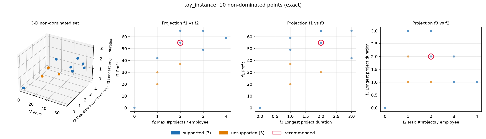
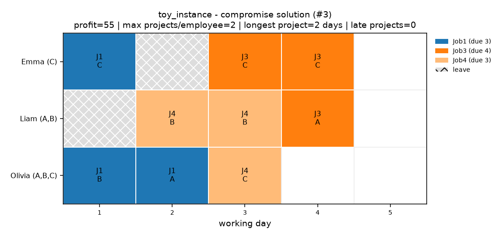

# CompuOpti: staffing engineers on client projects, with goals that pull against each other

This document explains the project to someone who has not seen it: what the subject asks, how we modelled it, how the solver finds every reasonable trade-off, what the results show so far, and what is still weak or unfinished.

Every number below is marked as **measured** (it comes from a run) or **estimated**.

---

## 0. Where things stand

| Part | Status |
|---|---|
| Model, algorithm, plots, generator, tests | **Done**, on this branch |
| Toy instance | **Done.** 10 trade-off solutions, proven complete |
| Medium instance | **Incomplete.** The first run had a bug; the re-run was interrupted |
| Large instance | **Not solved.** The solver cannot prove optimality within 60 s per call |
| Scalability benchmark | **Not run.** The script exists but was never executed |
| Defense slides | **Not started** (required by the subject) |

---

## 1. The problem

CompuOpti is a (fictional) consulting company. Its CEO, Margaux Dourtille, has a team of engineers and a list of client projects. She needs a timetable: for every engineer and every working day, either "nothing" or "work on project *j*, using skill *q*".

Each engineer has some skills (for example A and B) and some days off. Each project needs a number of *person-days* per skill, for example "4 days of A, 2 days of B". A project earns money only if it is **fully** done within the planning horizon. It pays a penalty for each day it finishes after its due date.

The subject lists five rules every timetable must respect:

1. **Qualification.** You can only work on skill A if you have skill A.
2. **One thing per day.** An engineer does at most one (project, skill) per day.
3. **Leave.** Nobody works on their days off.
4. **Coverage.** A project counts as done only if every skill requirement is fully covered.
5. **Once only.** A project is executed at most once.

The key difficulty: **there is more work than people.** Demand vs capacity on the three instances provided (measured):

| Instance | Days | Engineers | Projects | Skills | Person-days demanded | Person-days available | Demand / capacity |
|---|---:|---:|---:|---:|---:|---:|---:|
| toy | 5 | 3 | 5 | 3 | 14 | 13 | 108% |
| medium | 22 | 5 | 15 | 10 | 135 | 102 | 132% |
| large | 36 | 6 | 25 | 10 | 272 | 193 | 141% |

So the question is not only "when does each project happen" but also "which projects do we give up on". Even with perfect flexibility, a quarter to a third of the work cannot be done.

---

## 2. Why "the best schedule" doesn't exist

If money were the only goal, we would solve one optimisation problem and be done. But the subject suggests several goals at once: more profit, shorter projects, fewer projects per engineer, fewer late deliveries. These goals conflict. To earn the most, you squeeze in as many projects as possible. That means engineers juggle many projects, and projects get stretched over time.

When goals conflict, there is no single best answer. Instead we look for **non-dominated** (or **Pareto-optimal**) schedules. A schedule is *dominated* if another schedule is at least as good on every goal and strictly better on one. Nobody should ever pick a dominated schedule. What remains after removing them all is the **Pareto front**: the menu of genuine trade-offs. Choosing from that menu is the CEO's job, not the algorithm's.

> **Example from the toy instance (measured).** Schedule X earns 65, with each engineer on at most 2 projects and the longest project lasting 3 days. Schedule Y also earns 65, with up to 3 projects per engineer but the longest project lasting only 2 days. Neither beats the other: X is better for focus, Y is better for speed. Both are on the front.

The subject's own words: compute "the set of the non-dominated solutions" and visualise them both as points (objective space) and as actual timetables (decision space).

---

## 3. The four criteria we chose

The subject lists goals in words. Turning them into formulas requires choices, and the jury may ask about them.

| Name | Formula in words | Direction | Why this reading |
|---|---|---|---|
| **f1 Profit** | gains of completed projects − (daily penalty × days late) | max | Direct translation of the subject. |
| **f2 Max projects per engineer** | the largest number of different projects any one engineer works on | min | "Minimise the number of projects an employee works on." We protect the *worst-off* engineer (the max). The total over all engineers is also defensible. |
| **f3 Longest project duration** | for each completed project, days from its first to its last worked day; take the largest | min | "Minimise the actual project execution time." Read as calendar duration; person-days are fixed by the project anyway. |
| **f4 Late projects** | number of completed projects finished after their due date | min | Always computed and reported. It can replace f2 or f3 in the search (`--secondary` option). |

The search uses **three criteria at a time** (by default f1, f2, f3). Four at once is possible in principle, but the number of solver calls grows much faster, and a 4-D front is hard to show to a human.

---

## 4. The mathematical model

We write the problem as a **mixed-integer linear program (MIP)**: yes/no decisions, linear rules, a linear goal. The solver **Gurobi** (free academic licence) searches for the best combination of decisions. Code: `src/models/gurobi_model.py`.

### 4.1 Data (fixed)

| Symbol | Meaning |
|---|---|
| `H`, `T = {1..H}` | horizon and working days |
| `S`, `Q`, `J` | engineers, skills, projects |
| `QS_s` | skills of engineer `s` |
| `V_s` | days off of engineer `s` |
| `n_{j,q}` | person-days of skill `q` needed by project `j` |
| `G_j`, `d_j`, `c_j` | gain, due date, daily penalty of project `j` |

### 4.2 Decisions

| Symbol | Values | Meaning |
|---|---|---|
| `x[s,j,q,t]` | 0/1 | engineer `s` works on skill `q` of project `j` on day `t`. This is the timetable itself. |
| `y[j]` | 0/1 | project `j` is completed |
| `z[s,j]` | 0/1 | engineer `s` works on project `j` at least once (used to count f2) |
| `st[j,t]` | 0/1 | project `j` has **started** on or before day `t` |
| `fi[j,t]` | 0/1 | project `j` has **finished** on or before day `t` (`fi[j,0] = 0`) |
| `u[j]` | 0/1 | project `j` is late (for f4) |
| `P`, `D` | integers | the values of f2 and f3 |

One simple trick enforces two of the five rules for free. `x[s,j,q,t]` is only **created** if engineer `s` has skill `q`, project `j` needs `q`, and day `t` is not a day off. The solver cannot break the qualification and leave rules, because the forbidden variables don't exist.

### 4.3 Rules

| # | Rule | Meaning |
|---|---|---|
| C1 | `Σ_{j,q} x[s,j,q,t] ≤ 1` for all s, t | one thing per day |
| C2 | `Σ_{s,t} x[s,j,q,t] = n_{j,q} · y[j]` for all j, q | coverage **and** once-only in one line: a chosen project gets exactly what it needs, and nobody touches a project that isn't chosen (no wasted half-done work) |
| C3 | `x ≤ z[s,j]` and `z[s,j] ≤ Σ_{q,t} x[s,j,q,t]` | `z` means "s works on j" |
| C4 | `st[j,t-1] ≤ st[j,t]`, `fi[j,t-1] ≤ fi[j,t]`, `fi[j,t] ≤ st[j,t]` | started and finished are switches that stay on once turned on |
| C5 | `st[j,H] = fi[j,H] = y[j]` | a completed project starts and ends within the horizon; an uncompleted one never starts |
| C6 | `x[s,j,q,t] ≤ st[j,t]` and `x[s,j,q,t] ≤ 1 − fi[j,t−1]` | work only happens while the project is open |
| C7 | `D ≥ Σ_t (st[j,t] − fi[j,t−1])` for all j | the sum is the number of days the project is open, i.e. its duration |
| C8 | `u[j] ≥ y[j] − fi[j,d_j]` for all j with `d_j < H` | late means completed but not finished by the due date |
| C9 | `P ≥ Σ_j z[s,j]` for all s | max projects per engineer |

Lateness of project `j` (an expression, not a variable): `late_j = Σ_{t > d_j} (y[j] − fi[j,t−1])`. It counts the days after the due date on which a completed project is not yet finished, which equals `max(0, end_j − d_j)`.

Objectives: `f1 = Σ_j G_j·y[j] − c_j·late_j` (max), `f2 = P` (min), `f3 = D` (min), `f4 = Σ_j u[j]` (min).

### 4.4 The start/finish switches, pictured

Take a project worked on days 3 to 6. `st` turns on the day it starts and stays on. `fi` turns on after the last working day and stays on. The project is "open" while `st` is on and `fi` is still off:

| day | 1 | 2 | 3 | 4 | 5 | 6 | 7 | 8 |
|---|---|---|---|---|---|---|---|---|
| work | | | ■ | ■ | ■ | ■ | | |
| `st` (started) | 0 | 0 | 1 | 1 | 1 | 1 | 1 | 1 |
| `fi` (finished) | 0 | 0 | 0 | 0 | 0 | 1 | 1 | 1 |
| open? | no | no | yes | yes | yes | yes | no | no |

With these switches, every quantity becomes a simple count. Duration = open days (here 4). Lateness = days after the due date on which the project isn't finished.

The more obvious encoding ("end day ≥ every worked day", "start day ≤ every worked day unless that day isn't worked") needs so-called **big-M** constraints. Those are correct, but they give the solver very little guidance. Section 6 shows the measured difference. Both versions are kept in the code (`formulation="step"` or `"bigm"`) so the comparison can be reproduced.

---

## 5. Finding all the trade-offs: the ε-constraint method

Code: `src/algorithms/epsilon_constraint.py`.

### 5.1 Why not add up the goals with weights?

The tempting approach is a single score, such as `profit − 10·f2 − 5·f3`, maximised for several weight combinations. The problem, proven in the multi-objective optimisation lecture, is that this **misses solutions**. On problems with yes/no decisions, some Pareto-optimal schedules sit in "dents" of the front, and no choice of weights ever selects them. They are called **unsupported** solutions. On the toy instance, 3 of the 10 trade-off schedules are unsupported (measured). A weighted sum would have shown only 7.

### 5.2 The idea

Keep one goal (profit) and turn the others into **limits**: "maximise profit, subject to every engineer having at most *k* projects and no project lasting more than *e* days". Then sweep the limits systematically:

```
for k = (number of projects) down to 0:         # limit on f2
    e = horizon                                 # limit on f3
    repeat:
        find the max-profit schedule with f2 ≤ k and f3 ≤ e
          (ties broken by smaller f3, then smaller f2)
        record it
        e = (its f3) − 1                        # ask for something strictly shorter
    until e < 0
remove dominated schedules
```

Every criterion is a whole number, because the data has integer gains and penalties. So stepping the limits by 1 visits every possible trade-off. If every solver call ends with a proof of optimality, the method is **exact**: it finds the complete front, unsupported points included. Each run records whether this held (`summary.json` → `"exact"`).

### 5.3 Shortcuts that keep it exact

- **Level skipping.** Suppose that at limit *k* = 15, no schedule found uses more than 7 projects per engineer. Then limits 14, 13 … 7 would return exactly the same schedules, so the search jumps straight to *k* = 6. On medium this skips 8 of the 15 levels.
- **One solver call per schedule instead of three.** "Maximise profit, then among ties minimise f3, then f2" could be three successive solves. All values are bounded whole numbers, so it is encoded as one weighted objective. The weights are large enough that one unit of profit always outweighs any change in f3 and f2 combined. Same answer, faster (section 6).
- **Warm start.** Each call starts from the best schedule already found that satisfies the current limits. Then a call that hits its time limit can never return something worse than what is already known.

### 5.4 Supported or not?

Once the front is found, each point is tested with a tiny linear program: is there a set of strictly positive weights for which this point beats every other point? If yes, it is supported; if not, it is unsupported. Code: `src/algorithms/pareto.py`.

---

## 6. Making it fast enough

A front needs dozens of solver calls, so each call must be quick. All timings were **measured once** on an 8-thread laptop. They are single runs, so read them as orders of magnitude, not precise speed-ups.

| Medium instance, same question | Big-M formulation | Start/finish formulation |
|---|---|---|
| max profit, then min f2, then min f3 | **not proven**, stopped at the 120 s limit (131 s total) | **proven optimal**, 40 s |
| max profit, then min f3, then min f2 | **not proven**, stopped at the limit (199 s total) | **proven optimal**, 57 s |

| Medium instance, same question | 3 successive solves | 1 weighted solve |
|---|---:|---:|
| max profit, then f2, then f3 | 40 s | 24 s |
| max profit, then f3, then f2 | 57 s | 12 s |
| same, with limits f2 ≤ 3 and f3 ≤ 6 | **not proven**, 192 s | **proven**, 63 s |

Model sizes with the final formulation (measured): toy 165 variables / 393 constraints, medium 2,032 / 5,096, large 5,879 / 14,913. The start/finish version has about 40% more variables than big-M, yet it solves much faster. A model with more variables is not necessarily harder.

---

## 7. Can we trust the output?

1. **Independent checker.** Every schedule is re-checked by separate code that knows nothing about the solver: right skills, no leave days, one task per day, every project fully covered (`check_feasibility`). `run_pareto.py` refuses to save a schedule that fails.
2. **Objectives recomputed from the timetable.** Profit, f2, f3 and f4 are recalculated from the list of assignments (`evaluate_schedule`), not read from solver variables.
3. **Automated tests (8, all passing).** Toy max profit equals 65. The checker catches deliberate violations. Every pair of toy front points is mutually non-dominated. The generator never creates impossible projects.

Max profit is 65 on toy and 413 on medium, both proven optimal by the solver. We have not compared them with an official answer key.

---

## 8. Results

### 8.1 Toy instance: final, exact

3 engineers, 5 days, 5 projects. 15 solver calls, under 4 seconds, every call proven optimal (measured).

| # | Profit | Max projects / engineer | Longest project (days) | Late projects | Projects done | Type |
|---:|---:|---:|---:|---:|---:|---|
| 0 | 65 | 2 | 3 | 0 | 4 | supported |
| 1 | 65 | 3 | 2 | 0 | 4 | supported |
| 2 | 59 | 4 | 1 | 1 | 4 | supported |
| 3 | 55 | 2 | 2 | 0 | 3 | supported, **compromise** |
| 4 | 49 | 3 | 1 | 1 | 3 | supported |
| 5 | 42 | 1 | 3 | 1 | 3 | supported |
| 6 | 37 | 2 | 1 | 1 | 2 | unsupported |
| 7 | 30 | 1 | 2 | 0 | 2 | unsupported |
| 8 | 20 | 1 | 1 | 0 | 1 | unsupported |
| 9 | 0 | 0 | 0 | 0 | 0 | supported (empty schedule) |

**How to read it.**
- Going from 65 to 55 drops the 10-euro Job5. In exchange, every engineer stays on at most 2 projects and every project fits in 2 days.
- The schedule earning 20 does only Job4 (2 days of B, 1 of C), in a single day: all three engineers work on it on day 3, the one day nobody is on leave.
- Row 9, "do nothing", is always on the front, because nothing beats 0 projects and 0 days. It is mathematically correct and practically useless: we keep it in the list and exclude it when recommending.



*Objective space. Each dot is one non-dominated schedule. Blue dots are supported, orange dots are the unsupported ones a weighted sum would miss, and the red circle is the default compromise (#3).*



*Decision space for the compromise schedule (#3). Rows are engineers (with their skills), columns are days, and hatched cells are leave. Profit 55, nobody on more than 2 projects, no project longer than 2 days, nothing late.*


*Decision space for a max-profit schedule: four projects for 65; the longest project spans 3 days.*

### 8.2 Medium instance: preliminary, incomplete

> The first full medium run (57 solver calls, 44 minutes) had a bug that skipped part of the front (section 9), and 5 of its calls stopped at the time limit. The re-run with the fix was interrupted. The numbers below are individual points that **were proven optimal** for their limits, so each value is correct. But the list is **not complete** and must not be presented as the medium front.

**Price of short projects** (no limit on projects per engineer, measured):

| Longest project allowed | 8 days | 6 | 5 | 4 | 3 | 2 |
|---|---:|---:|---:|---:|---:|---:|
| Best profit | 413 | 411 | 406 | 380 | 265 | 30 |

**Price of focus** (no limit on duration, measured):

| Max projects per engineer | ≤ 5 | 4 | 3 | 2 | 1 |
|---|---:|---:|---:|---:|---:|
| Best profit | 413 | 405 | 382 | 326 | 194 |

Preliminary reading: the last few percent of profit are cheap to give up. Capping projects at 6 days costs 2 out of 413; capping engineers at 4 projects costs 8. Below that, losses grow fast: 3-day projects cost over a third of the profit.

### 8.3 Large instance: not solved

Every solver call on large hit its 60-second limit without proof. The best schedule found so far earns 810. An unconstrained call returned 808, and a *more constrained* call then found 810. That proves the calls are not reaching the optimum here. Any large front will be an **approximation** and must be labelled as such. For large, `run_pareto.py --step jump` trades coverage for speed.

### 8.4 Benchmark on generated instances: not run

The subject requires an instance generator, and it exists (`src/generator.py`). It controls size, skills per engineer, leave rate, demand/capacity ratio and due-date tightness, and it guarantees every needed skill exists in the team. `benchmark.py` (12 instances, timing the max-profit solve and the full front) has not been run, so there are no scalability numbers yet.

---

## 9. Problems found along the way

- **Gurobi crash.** Gurobi's built-in multi-objective feature (`setObjectiveN`, version 13.0.3) crashed the Python process when objectives were redefined on the same model. We implemented the priority order ourselves.
- **Lateness formula.** A first version counted "open days after the due date". That undercounts lateness when a project *starts* after its due date. It was caught by reasoning before any results were produced. The correct form counts the days after the due date until the project is finished.
- **Skipped trade-offs.** When a call hit its time limit, it sometimes returned only the "do nothing" schedule. The search then believed nothing shorter existed and skipped the rest of that level. This is why the first medium run is unusable. Fixes: the warm start (5.3), and after an unproven call the duration limit drops by only 1 (`--step safe`, the default).
- **Time limit not respected.** One call ran 669 s with a 120 s limit. The cause is unknown, so run-time estimates carry this risk.

---

## 10. Picking one schedule

The algorithm delivers a menu. As a starting point, the code highlights a **compromise**: the schedule whose worst criterion, scaled between the best and worst values on the front, is as good as possible. Technically, this is the weighted Tchebychev distance to the ideal point, with equal weights. The empty schedule is excluded. On toy this picks #3: profit 55, 2 projects per engineer, 2-day projects.

**Equal weights are an arbitrary choice.** We never asked the CEO what she values. The proper next step would be to show her a few schedules from the front, ask her to rank them, and infer her preferences from that ranking, for example with the UTA method from the course. A UTA solver exists in the course exercises folder (`../Exercises/solvers/uta_solver.py`), but it is **not connected** to this project.

---

## 11. Weaknesses, most serious first

1. **Only the toy front is final.** Medium is incomplete and large is unsolved. A defense today would show results on one 3-engineer instance.
2. **Exactness does not scale.** The method is exact only if every call is proven optimal. On medium the hardest limits need minutes per call; on large no call is proven within a minute. The subject suggests approximate methods for that case. We only have a time-limited version of the exact method, not a dedicated heuristic.
3. **No scalability evidence.** The generator and benchmark exist, but there are no numbers.
4. **Criteria interpretations are choices.** f2 is the max over engineers and f3 is the longest project. A different reading (sum of projects per engineer, total duration) gives a different front. Defensible, but it must be stated.
5. **f4 is not searched jointly.** Late projects are reported for every schedule and can replace f2 or f3, but the four-criteria front is not computed.
6. **The compromise is not preference-based** (section 10).
7. **Timings are single runs** on one laptop. They are good enough to show that one formulation is several times faster, not to state a precise factor.
8. **No slides yet**, although they are a required deliverable.

---

## 12. What is left, and how long it takes

| Task | Estimated time | Basis |
|---|---|---|
| Complete medium front (300 s limit per call) | 1–1.5 h | estimate from the first run (44 min at 120 s), plus the slow calls |
| Approximate large front | ~1.5 h | fixed budget set in the command |
| Benchmark (12 generated instances) | 40–70 min | estimate; upper bound 84 min |
| Results write-up and slides | not estimated | depends on the team |

To reproduce or continue (from the `DMP/` folder, with the Gurobi licence active):

```bash
python -m pytest -q tests
python run_pareto.py data/toy_instance.json
python run_pareto.py data/medium_instance.json --time-per-solve 300
python run_pareto.py data/large_instance.json --time-per-solve 60 --total-time 5400 --step jump
python benchmark.py
```

Each run writes to `results/<instance>/` the following files:
- the front as CSV and JSON (the JSON includes every timetable);
- the objective-space figure;
- two timetable figures;
- a `summary.json` whose `"exact"` field says whether the front is proven complete.

---

## 13. Code map

| File | Role |
|---|---|
| `src/io_parser.py` | JSON → `ProblemInstance` |
| `src/models/gurobi_model.py` | MIP (`step` and `bigm` variants), ε limits, priority-order solves, warm start, `evaluate_schedule` and `check_feasibility` |
| `src/algorithms/epsilon_constraint.py` | exact ε-constraint with level skipping, time budgets, exactness flag |
| `src/algorithms/pareto.py` | dominance, non-dominated filter, supported/unsupported test |
| `src/visualization/plots.py` | objective-space figure (3-D + three 2-D projections) and decision-space timetable |
| `src/generator.py` | synthetic instance generator |
| `run_pareto.py` | computes and plots the front of one instance |
| `benchmark.py` | scalability study on generated instances |
| `tests/` | 8 pytest tests |

---

## 14. Glossary

- **Dominated.** A schedule is dominated if another is at least as good on every criterion and strictly better on one.
- **Pareto front.** All non-dominated schedules: the menu of genuine trade-offs.
- **Supported / unsupported.** Supported points can be found by maximising some weighted sum of the criteria. Unsupported ones cannot, and need a method like ε-constraint.
- **ε-constraint.** Optimise one criterion while the others become upper limits (the ε values), then move the limits step by step.
- **Lexicographic.** Optimise criteria in a strict priority order: the second only breaks ties of the first, and so on.
- **MIP.** Mixed-integer program: an optimisation model with yes/no or whole-number decisions and linear rules.
- **Big-M.** A modelling trick that switches a rule on or off with a large constant. Correct but often slow for the solver.
- **Proven optimal.** The solver has a mathematical guarantee that no better solution exists, not just a good solution.
- **Ideal / nadir point.** The best (ideal) and worst (nadir) value of each criterion over the front, used to scale criteria.
- **Person-day.** One engineer working one day.
