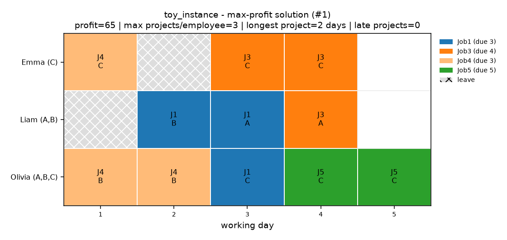
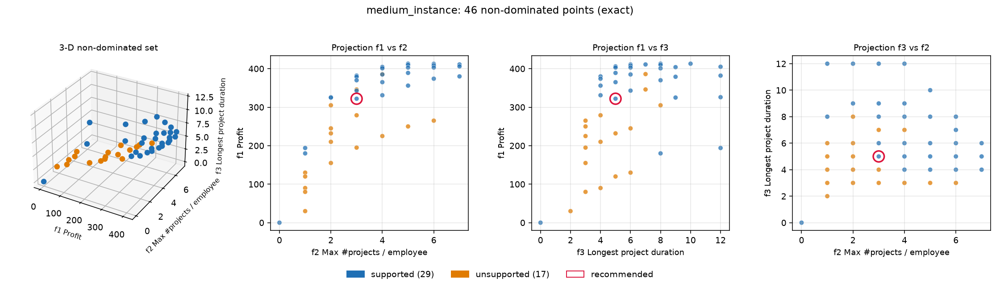
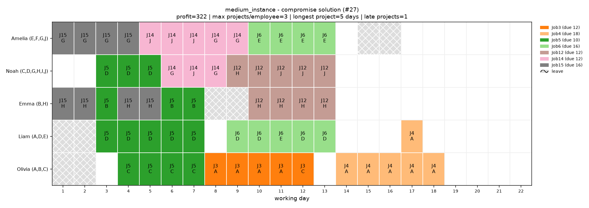
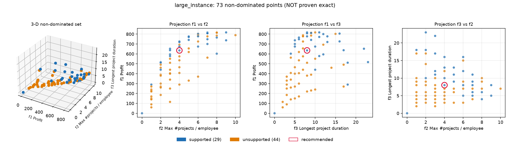
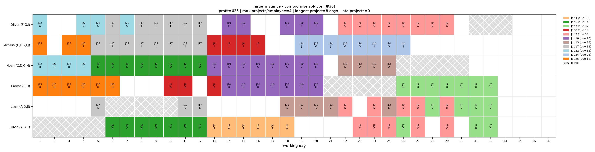
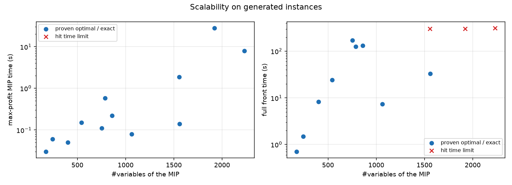

# CompuOpti: staffing engineers on client projects, with goals that pull against each other

This document explains the project to someone who has not seen it: what the subject asks, how we modelled it, how the solver finds every reasonable trade-off, what the results show so far, and what is still weak or unfinished.

Every number below is marked as **measured** (it comes from a run) or **estimated**.

---

## 0. Where things stand

| Part | Status |
|---|---|
| Model, algorithm, plots, generator, tests | **Done**, on this branch |
| Toy instance | **Done.** 10 trade-off solutions, proven complete |
| Medium instance | **Done.** 46 trade-off solutions, proven complete (53 min) |
| Large instance | **Approximate, certified.** 73 trade-off solutions (4.7 h of solves). Proven: the max profit (817), the best profit for 16 of 67 limit pairs, the "1 project per engineer" slice. Elsewhere a proven gap: median 6.0%, max 38% (section 8.3) |
| Scalability benchmark | **Done.** 12 generated instances; fronts exact up to ~1,000 variables within 5 min |
| Report | **Done.** `docs/report/CompuOpti_report.pdf`, rebuilt from `results/` by `docs/report/build_report.py` |
| Defense slides | **Done** outside the repo (claude.ai deck); figures in `docs/slides/` |

---

## 1. The problem

CompuOpti is a (fictional) consulting company. Its CEO, Margaux Dourtille, has a team of engineers and a list of client projects. She needs a timetable: for every engineer and every working day, either "nothing" or "work on project *j*, using skill *q*".

Each engineer has some skills (for example A and B) and some days off. Each project needs a number of *person-days* per skill, for example "4 days of A, 2 days of B". A project earns money only if it is **fully** done within the planning horizon. It pays a penalty for each day it finishes after its due date.

The subject lists five rules every timetable must respect:

1. **Qualification.** You can only work on skill A if you have skill A.
2. **One thing per day.** An engineer does at most one (project, skill) per day.
3. **Leave.** Nobody works on their days off.
4. **Coverage.** A project counts as done only if every skill requirement is fully covered.
5. **Once only.** A project is executed at most once.

The key difficulty: **there is more work than people.** Demand vs capacity on the three instances provided (measured):

| Instance | Days | Engineers | Projects | Skills | Person-days demanded | Person-days available | Demand / capacity |
|---|---:|---:|---:|---:|---:|---:|---:|
| toy | 5 | 3 | 5 | 3 | 14 | 13 | 108% |
| medium | 22 | 5 | 15 | 10 | 135 | 102 | 132% |
| large | 36 | 6 | 25 | 10 | 272 | 193 | 141% |

So the question is not only "when does each project happen" but also "which projects do we give up on". Even with perfect flexibility, a quarter to a third of the work cannot be done.

**Do all projects have to be completed (even if late)?** No, and they *cannot* be.
- The subject says it explicitly: the tool must help Margaux "bearing in mind that not all projects can always be staffed", and a project "generates revenue *if* completed".
- The arithmetic settles it anyway. On the toy, the 5 projects need 14 person-days but the 3 engineers have only 13 working days between them (5 + 4 + 4 after leave). Completing all 5 is impossible, late or not. The same holds on medium (135 needed vs 102 available) and large (272 vs 193).
- "Late" only exists **inside** the horizon. A project can finish after its due date (and pay the daily penalty), but it must finish by the last day. Work after the horizon is not modelled, because the data stops there.
- Choosing *which* projects to drop is therefore part of the optimisation. Rule C2 below makes a project all-or-nothing: either it gets every person-day it needs, or nobody touches it.

**Can two engineers with the same skill work on the same project at the same time?** Yes.
- The subject's own example schedule (page 1) does it. On day 2, Alice and Charlie both work on "I, A".
- Our model allows it. The only per-day limit is on the *engineer* (one task per day). There is no limit on how many engineers share a (project, skill, day).
- It speeds the project up. A skill that needs 2 person-days can be done in 1 calendar day by 2 people. Example from the toy front (point #8, measured): Job4 needs 2 days of B and 1 day of C. On day 3, Olivia and Liam both do B and Emma does C, so the whole project takes **1 day** instead of 2.
- The solver uses this a lot. It appears in 38 of the 46 medium front points (measured).
- **Simplifying assumption:** the model treats person-days as perfectly splittable, so 2 people for 1 day count the same as 1 person for 2 days. In real teams, adding people does not always speed work up (coordination cost). The subject does not ask us to model that, but the jury may raise it.

---

## 2. Why "the best schedule" doesn't exist

If money were the only goal, we would solve one optimisation problem and be done. But the subject suggests several goals at once: more profit, shorter projects, fewer projects per engineer, fewer late deliveries. These goals conflict. To earn the most, you squeeze in as many projects as possible. That means engineers juggle many projects, and projects get stretched over time.

When goals conflict, there is no single best answer. Instead we look for **non-dominated** (or **Pareto-optimal**) schedules. A schedule is *dominated* if another schedule is at least as good on every goal and strictly better on one. Nobody should ever pick a dominated schedule. What remains after removing them all is the **Pareto front**: the menu of genuine trade-offs. Choosing from that menu is the CEO's job, not the algorithm's.

> **Example from the toy instance (measured).** Schedule X earns 65, with each engineer on at most 2 projects and the longest project lasting 3 days. Schedule Y also earns 65, with up to 3 projects per engineer but the longest project lasting only 2 days. Neither beats the other: X is better for focus, Y is better for speed. Both are on the front.

The subject's own words: compute "the set of the non-dominated solutions" and visualise them both as points (objective space) and as actual timetables (decision space).

---

## 3. The four criteria we chose

The subject lists goals in words. Turning them into formulas requires choices, and the jury may ask about them.

| Name | Formula in words | Direction | Why this reading |
|---|---|---|---|
| **f1 Profit** | gains of completed projects − (daily penalty × days late) | max | Direct translation of the subject. |
| **f2 Max projects per engineer** | the largest number of different projects any one engineer works on | min | "Minimise the number of projects an employee works on." We protect the *worst-off* engineer (the max). The total over all engineers is also defensible. |
| **f3 Longest project duration** | for each completed project, days from its first to its last worked day; take the largest | min | "Minimise the actual project execution time." Read as calendar duration; person-days are fixed by the project anyway. |
| **f4 Late projects** | number of completed projects finished after their due date | min | Always computed and reported. It can replace f2 or f3 in the search (`--secondary` option). |

The search uses **three criteria at a time** (by default f1, f2, f3). Four at once is possible in principle, but the number of solver calls grows much faster, and a 4-D front is hard to show to a human.

---

## 4. The mathematical model

We write the problem as a **mixed-integer linear program (MIP)**: yes/no decisions, linear rules, a linear goal. The solver **Gurobi** (free academic licence) searches for the best combination of decisions. Code: `src/models/gurobi_model.py`.

### 4.1 Data (fixed)

| Symbol | Meaning |
|---|---|
| `H`, `T = {1..H}` | horizon and working days |
| `S`, `Q`, `J` | engineers, skills, projects |
| `QS_s` | skills of engineer `s` |
| `V_s` | days off of engineer `s` |
| `n_{j,q}` | person-days of skill `q` needed by project `j` |
| `G_j`, `d_j`, `c_j` | gain, due date, daily penalty of project `j` |

### 4.2 Decisions

| Symbol | Values | Meaning |
|---|---|---|
| `x[s,j,q,t]` | 0/1 | engineer `s` works on skill `q` of project `j` on day `t`. This is the timetable itself. |
| `y[j]` | 0/1 | project `j` is completed |
| `z[s,j]` | 0/1 | engineer `s` works on project `j` at least once (used to count f2) |
| `st[j,t]` | 0/1 | project `j` has **started** on or before day `t` |
| `fi[j,t]` | 0/1 | project `j` has **finished** on or before day `t` (`fi[j,0] = 0`) |
| `u[j]` | 0/1 | project `j` is late (for f4) |
| `P`, `D` | integers | the values of f2 and f3 |

One simple trick enforces two of the five rules for free. `x[s,j,q,t]` is only **created** if engineer `s` has skill `q`, project `j` needs `q`, and day `t` is not a day off. The solver cannot break the qualification and leave rules, because the forbidden variables don't exist.

### 4.3 Rules

| # | Rule | Meaning |
|---|---|---|
| C1 | `Σ_{j,q} x[s,j,q,t] ≤ 1` for all s, t | one thing per day |
| C2 | `Σ_{s,t} x[s,j,q,t] = n_{j,q} · y[j]` for all j, q | coverage **and** once-only in one line: a chosen project gets exactly what it needs, and nobody touches a project that isn't chosen (no wasted half-done work) |
| C3 | `x ≤ z[s,j]` and `z[s,j] ≤ Σ_{q,t} x[s,j,q,t]` | `z` means "s works on j" |
| C4 | `st[j,t-1] ≤ st[j,t]`, `fi[j,t-1] ≤ fi[j,t]`, `fi[j,t] ≤ st[j,t]` | started and finished are switches that stay on once turned on |
| C5 | `st[j,H] = fi[j,H] = y[j]` | a completed project starts and ends within the horizon; an uncompleted one never starts |
| C6 | `x[s,j,q,t] ≤ st[j,t]` and `x[s,j,q,t] ≤ 1 − fi[j,t−1]` | work only happens while the project is open |
| C7 | `D ≥ Σ_t (st[j,t] − fi[j,t−1])` for all j | the sum is the number of days the project is open, i.e. its duration |
| C8 | `u[j] ≥ y[j] − fi[j,d_j]` for all j with `d_j < H` | late means completed but not finished by the due date |
| C9 | `P ≥ Σ_j z[s,j]` for all s | max projects per engineer |

Lateness of project `j` (an expression, not a variable): `late_j = Σ_{t > d_j} (y[j] − fi[j,t−1])`. It counts the days after the due date on which a completed project is not yet finished, which equals `max(0, end_j − d_j)`.

Objectives: `f1 = Σ_j G_j·y[j] − c_j·late_j` (max), `f2 = P` (min), `f3 = D` (min), `f4 = Σ_j u[j]` (min).

### 4.4 The start/finish switches, pictured

Take a project worked on days 3 to 6. `st` turns on the day it starts and stays on. `fi` turns on after the last working day and stays on. The project is "open" while `st` is on and `fi` is still off:

| day | 1 | 2 | 3 | 4 | 5 | 6 | 7 | 8 |
|---|---|---|---|---|---|---|---|---|
| work | | | ■ | ■ | ■ | ■ | | |
| `st` (started) | 0 | 0 | 1 | 1 | 1 | 1 | 1 | 1 |
| `fi` (finished) | 0 | 0 | 0 | 0 | 0 | 1 | 1 | 1 |
| open? | no | no | yes | yes | yes | yes | no | no |

With these switches, every quantity becomes a simple count. Duration = open days (here 4). Lateness = days after the due date on which the project isn't finished.

The more obvious encoding ("end day ≥ every worked day", "start day ≤ every worked day unless that day isn't worked") needs so-called **big-M** constraints. Those are correct, but they give the solver very little guidance. Section 6 shows the measured difference. Both versions are kept in the code (`formulation="step"` or `"bigm"`) so the comparison can be reproduced.

---

## 5. Finding all the trade-offs: the ε-constraint method

Code: `src/algorithms/epsilon_constraint.py`.

### 5.1 Why not add up the goals with weights?

The tempting approach is a single score, such as `profit − 10·f2 − 5·f3`, maximised for several weight combinations. The problem, proven in the multi-objective optimisation lecture, is that this **misses solutions**. On problems with yes/no decisions, some Pareto-optimal schedules sit in "dents" of the front, and no choice of weights ever selects them. They are called **unsupported** solutions. On the toy instance, 3 of the 10 trade-off schedules are unsupported (measured). A weighted sum would have shown only 7.

### 5.2 The idea

Keep one goal (profit) and turn the others into **limits**: "maximise profit, subject to every engineer having at most *k* projects and no project lasting more than *e* days". Then sweep the limits systematically:

```
for k = (number of projects) down to 0:         # limit on f2
    e = horizon                                 # limit on f3
    repeat:
        find the max-profit schedule with f2 ≤ k and f3 ≤ e
          (ties broken by smaller f3, then smaller f2)
        record it
        e = (its f3) − 1                        # ask for something strictly shorter
    until e < 0
remove dominated schedules
```

#### Walk-through on the toy instance (the real log, 15 solver calls)

Read `[f2 ≤ k, f3 ≤ e]` as the question "what is the most profit I can make if no engineer touches more than *k* projects **and** no project lasts more than *e* days?". The solver answers with the best schedule, and we note its actual f2 and f3.

| call | question: f2 ≤ k, f3 ≤ e | answer: profit, f2, f3 | what we do next |
|---:|---|---|---|
| 1 | k=5, e=5 (no real limit) | **65**, 3, 2 | Max profit is 65. Its longest project is 2 days. Can we get shorter? Ask e ≤ 1. |
| 2 | k=5, e=1 | **59**, 4, 1 | 1-day projects cost 6 of profit. Ask e ≤ 0. |
| 3 | k=5, e=0 | 0, 0, 0 | Only "do nothing" has duration 0. Level done. The largest f2 seen was 4, so limits 5 and 4 add nothing new (level skipping). Next k = 3. |
| 4 | k=3, e=5 | 65, 3, 2 | Same as call 1. |
| 5 | k=3, e=1 | **49**, 3, 1 | |
| 6 | k=3, e=0 | 0 | Level done. Next k = 2. |
| 7 | k=2, e=5 | **65**, 2, 3 | Still 65 with only 2 projects per engineer, but the longest project now takes 3 days. |
| 8 | k=2, e=2 | **55**, 2, 2 | |
| 9 | k=2, e=1 | **37**, 2, 1 | |
| 10 | k=2, e=0 | 0 | Next k = 1. |
| 11–14 | k=1, e = 5, 2, 1, 0 | **42**/1/3, **30**/1/2, **20**/1/1, 0 | |
| 15 | k=0, e=5 | 0, 0, 0 | Nobody may work, so we stop. |

Then we delete dominated answers. Call 4 repeats call 1, and call 2 (59, 4, 1) stays because no other point beats it on all three goals. That leaves the **10 schedules** in section 8.1.

Two things to see in this table:
- **Why "≤" and not "=".** The limit is a ceiling. "f3 ≤ 2" allows durations 0, 1 or 2, and the solver picks whatever earns most. That is why call 1 asked for ≤ 5 but got 2: the best schedule happened to be short already.
- **Why the next limit is "its f3 − 1".** After finding (65, f3 = 2), asking "f3 ≤ 2" again would return the same schedule. Asking "f3 ≤ 1" forces something strictly shorter. Because durations are whole numbers, nothing between 1 and 2 can be skipped.

Every criterion is a whole number, because the data has integer gains and penalties. So stepping the limits by 1 visits every possible trade-off. If every solver call ends with a proof of optimality, the method is **exact**: it finds the complete front, unsupported points included. Each run records whether this held (`summary.json` → `"exact"`).

### 5.3 Shortcuts that keep it exact

- **Level skipping.** Suppose that at limit *k* = 15, no schedule found uses more than 7 projects per engineer. Then limits 14, 13 … 7 would return exactly the same schedules, so the search jumps straight to *k* = 6. On medium this skips 8 of the 15 levels.
- **One solver call per schedule instead of three.** "Maximise profit, then among ties minimise f3, then f2" could be three successive solves. All values are bounded whole numbers, so it is encoded as one weighted objective. The weights are large enough that one unit of profit always outweighs any change in f3 and f2 combined. Same answer, faster (section 6).
- **Warm start.** Each call starts from the best schedule already found that satisfies the current limits. Then a call that hits its time limit can never return something worse than what is already known.

### 5.4 Supported or not?

Once the front is found, each point is tested with a tiny linear program: is there a set of strictly positive weights for which this point beats every other point? If yes, it is supported; if not, it is unsupported. Code: `src/algorithms/pareto.py`.

---

## 6. Making it fast enough

A front needs dozens of solver calls, so each call must be quick. All timings were **measured once** on an 8-thread laptop. They are single runs, so read them as orders of magnitude, not precise speed-ups.

| Medium instance, same question | Big-M formulation | Start/finish formulation |
|---|---|---|
| max profit, then min f2, then min f3 | **not proven**, stopped at the 120 s limit (131 s total) | **proven optimal**, 40 s |
| max profit, then min f3, then min f2 | **not proven**, stopped at the limit (199 s total) | **proven optimal**, 57 s |

| Medium instance, same question | 3 successive solves | 1 weighted solve |
|---|---:|---:|
| max profit, then f2, then f3 | 40 s | 24 s |
| max profit, then f3, then f2 | 57 s | 12 s |
| same, with limits f2 ≤ 3 and f3 ≤ 6 | **not proven**, 192 s | **proven**, 63 s |

Model sizes with the final formulation (measured): toy 165 variables / 393 constraints, medium 2,032 / 5,096, large 5,879 / 14,913. The start/finish version has about 40% more variables than big-M, yet it solves much faster. A model with more variables is not necessarily harder.

---

## 7. Can we trust the output?

1. **Independent checker.** Every schedule is re-checked by separate code that knows nothing about the solver: right skills, no leave days, one task per day, every project fully covered (`check_feasibility`). `run_pareto.py` refuses to save a schedule that fails.
2. **Objectives recomputed from the timetable.** Profit, f2, f3 and f4 are recalculated from the list of assignments (`evaluate_schedule`), not read from solver variables.
3. **Automated tests (9, all passing).** Toy max profit equals 65. The checker catches deliberate violations. Every pair of toy front points is mutually non-dominated. The generator never creates impossible projects. Resuming an interrupted run from its checkpoint gives the same front.

Max profit is 65 on toy and 413 on medium, both proven optimal by the solver. We have not compared them with an official answer key.

---

## 8. Results

### 8.1 Toy instance: final, exact

3 engineers, 5 days, 5 projects. 15 solver calls, under 4 seconds, every call proven optimal (measured).

| # | Profit | Max projects / engineer | Longest project (days) | Late projects | Projects done | Type |
|---:|---:|---:|---:|---:|---:|---|
| 0 | 65 | 2 | 3 | 0 | 4 | supported |
| 1 | 65 | 3 | 2 | 0 | 4 | supported |
| 2 | 59 | 4 | 1 | 1 | 4 | supported |
| 3 | 55 | 2 | 2 | 0 | 3 | supported, **compromise** |
| 4 | 49 | 3 | 1 | 1 | 3 | supported |
| 5 | 42 | 1 | 3 | 1 | 3 | supported |
| 6 | 37 | 2 | 1 | 1 | 2 | unsupported |
| 7 | 30 | 1 | 2 | 0 | 2 | unsupported |
| 8 | 20 | 1 | 1 | 0 | 1 | unsupported |
| 9 | 0 | 0 | 0 | 0 | 0 | supported (empty schedule) |

**How to read it.**
- Going from 65 to 55 drops the 10-euro Job5. In exchange, every engineer stays on at most 2 projects and every project fits in 2 days.
- The schedule earning 20 does only Job4 (2 days of B, 1 of C), in a single day: all three engineers work on it on day 3, the one day nobody is on leave.
- Row 9, "do nothing", is always on the front, because nothing beats 0 projects and 0 days. It is mathematically correct and practically useless: we keep it in the list and exclude it when recommending.


*Objective space. Each dot is one non-dominated schedule. Blue dots are supported, orange dots are the unsupported ones a weighted sum would miss, and the red circle is the default compromise (#3).*


*Decision space for the compromise schedule (#3). Rows are engineers (with their skills), columns are days, and hatched cells are leave. Profit 55, nobody on more than 2 projects, no project longer than 2 days, nothing late.*



*Decision space for a max-profit schedule: four projects for 65; the longest project spans 3 days.*

### 8.2 Medium instance: final, exact

5 engineers, 22 days, 15 projects, 10 skills. **46 non-dominated schedules (29 supported, 17 unsupported), proven complete** (measured).
- 61 solver calls, all proven optimal, 53 minutes in total.
- Median call 24 s, slowest 244 s; 19 calls took more than 60 s. The limit was 300 s per call and no call reached it.
- Run settings: `--time-per-solve 300 --threads 4`, in parallel with the large run, so the timings are not from a quiet machine.

| | Profit | Max projects / engineer | Longest project (days) | Late projects | Projects done (of 15) |
|---|---:|---:|---:|---:|---:|
| Max profit (one of the 413 schedules) | 413 | 5 | 10 | 3 | 11 |
| Default compromise (#27) | 322 | 3 | 5 | 1 | 7 |

**Price of short projects** (best profit on the front with no project longer than the cap, any number of projects per engineer; measured):

| Longest project allowed | ≥ 8 days | 6 | 5 | 4 | 3 | 2 |
|---|---:|---:|---:|---:|---:|---:|
| Best profit | 413 | 411 | 406 | 380 | 265 | 30 |
| Loss vs 413 | 0 | 0.5% | 1.7% | 8% | 36% | 93% |

**Price of focus** (best profit with at most *k* projects per engineer, any duration; measured):

| Max projects per engineer | ≥ 5 | 4 | 3 | 2 | 1 |
|---|---:|---:|---:|---:|---:|
| Best profit | 413 | 405 | 382 | 326 | 194 |
| Loss vs 413 | 0 | 1.9% | 7.5% | 21% | 53% |

**How to read it.** The last few percent of profit are cheap to give up. Capping projects at 5 days costs 7 out of 413, and capping engineers at 4 projects costs 8. Below that, the losses grow fast: 3-day projects cost over a third of the profit, and 1 project per engineer costs half.

**Careful: the limits interact.** Each table above relaxes the other criterion completely. Imposing both cheap limits at once (≤ 5-day projects **and** ≤ 4 projects per engineer) costs 48, i.e. 365 (−11.6%), not "under 2% each". A cheap combination does exist: ≤ 6-day projects with ≤ 5 projects per engineer still earns 403 (−2.4%). The full table of optimal profits for every pair of limits is `docs/slides/heatmap_medium.png`, built by `docs/slides/make_slide_figures.py`.

The compromise is less obvious than it looks. It gives up 22% of the profit to reach 3 projects per engineer and 5-day projects. That is the price of the equal weights, not a recommendation (section 10).



*Medium objective space. 17 of the 46 points (orange) are unsupported: a weighted-sum method would have missed 37% of the trade-offs.*



### 8.3 Large instance: approximate, certified point by point

6 engineers, 36 days, 25 projects, 10 skills, 141% demand. Here the solver can no longer prove optimality within a minute per call, so the front is an **approximation**: every schedule in it is feasible and checked, but better trade-offs may exist. We therefore also measured how far each point can be from the best possible (run C).

**What we ran (measured):**

| Run | Points | Calls | Calls proven optimal | Time | What it covered |
|---|---:|---:|---:|---:|---|
| A: one weighted solve per point, 60 s per call, `--step jump` | 61 | 103 | 18 | 1.5 h (budget) | engineer limits 25 → 2; budget ran out before limit 1 |
| B: profit, then duration, then focus solved one after the other, 60 s per stage | 13 | 30 | 9 | 1 h (budget) | only the top levels, engineer limit ≥ 7 (the high-profit end); budget ran out at 7 |
| A + B merged (kept in `results/large_merged_before_certify`) | 68 (27 supported) | 133 | | 2.5 h | the "first approximation" |
| C: certificate (`certify_front.py`), 120 s per call | 57 new, 52 kept | 71 | 16 | 2.2 h | one call per point of A + B, plus the level "1 project per engineer" |
| **A + B + C merged** (`--merge`) | **73** (29 supported) | 204 | | 4.7 h | union, re-checked, dominated points removed |

**The certificate (run C).** For each point of A + B, with profit p, at most a projects per engineer and a longest project of b days, we ask Gurobi for the best profit with "at most a projects per engineer and projects of at most b days" (120 s, starting from the point). Gurobi returns the best schedule it finds and a **proven upper bound** UB, which we cap at 817 (no schedule earns more). So the best possible profit within these limits lies between what we found and UB, and (UB − found) / UB is a proven bound on the share of profit we may be missing. Measured:

- **The first approximation was weak.** Run C found better schedules for 47 of the 67 points (up to +101 profit), and **47 of the 68 points of A + B are dominated** in the merged front. Without the certificate we would have presented that front as "the large front".
- **After certification:** 16 of the 67 limit pairs are proven optimal; the gap has median 6.0% (10.5% before run C) and maximum 38.0%.
- **It is tight where a decision is likely.** For the 22 limit pairs whose best profit is at least 90% of the maximum, the median gap is 2.4% (largest 9.8%).
- **It is loose in the middle.** All 13 gaps above 20% have moderately tight limits (at most 5 projects per engineer and 10-day projects). There, neither our schedules nor the bounds converged in 120 s, so we cannot tell which side is weak. For limits of 4+ projects and 6+ days, every bound lies between 743 and 817, close to the global maximum.
- **One slice is exact.** The level "1 project per engineer", never reached by A or B, was swept with proven solves: 10 points, from 60 (2-day projects) to 290 (18-day projects). Each call proves the best profit for its duration limit and the next limit starts one day below the duration found, so no limit is skipped.

**Why there are two runs.** Run A's best schedule earned 811. A separate max-profit solve, with no tie-breaking goals, proved in **13 s** that the true maximum is **817** (`results/large/max_profit_bound.json`). So run A missed the top of the front. The combined objective (profit weighted so heavily that duration and focus only break ties) is much harder to *prove* than profit alone. Run B solves profit first and freezes it, then the other goals. It found 817 straight away.

Run B added 10 points and pushed out 3 of run A's points, all at the high-profit end (profit ≥ 584). Run A's coverage of the low-profit, focused schedules is still the only one available.

| | Profit | Max projects / engineer | Longest project (days) | Late | Projects done (of 25) |
|---|---:|---:|---:|---:|---:|
| Max profit (proven optimal profit) | 817 | 9 | 8 | 2 | 17 |
| Default compromise (#30) | 635 | 4 | 8 | 0 | 11 |

(Before run C the compromise was 620 with the same limits and 2 late projects: run C found a better schedule in that box.)

**Price of short projects and of focus** on the merged front. These are what we *found*, i.e. lower bounds; the true best profit for each cap may be higher, so each loss is an upper bound on the true loss.

| Longest project allowed | ≥ 8 | 7 | 6 | 5 | 4 | 3 |
|---|---:|---:|---:|---:|---:|---:|
| Best profit found | 817 | 789 | 765 | 737 | 602 | 370 |

| Max projects per engineer | ≥ 7 | 6 | 5 | 4 | 3 | 2 | 1 |
|---|---:|---:|---:|---:|---:|---:|---:|
| Best profit found | 817 | 805 | 777 | 726 | 652 | 517 | 290 (proven) |

Same shape as on medium: flat for loose limits, collapsing for tight ones. ≤ 6-day projects cost at most 6.4%, ≤ 4 projects per engineer at most 11.1%. At equal limits these losses are larger than on medium (≤ 5-day projects: at most 9.8% here, 1.7% there). Two possible reasons, not tested: large has more projects per engineer (25 for 6 vs 15 for 5), and these values are only lower bounds.

**Supported / unsupported is relative here.** The test compares a point only with the other points found. On an incomplete front, a point labelled "unsupported" might become dominated, or a supported one might lose that status, once more points are found.





### 8.4 Benchmark on generated instances

The subject requires an instance generator (`src/generator.py`). It controls size, skills per engineer, leave rate, demand/capacity ratio (default 1.3, like the given instances) and due-date tightness, and it guarantees every needed skill exists in the team.

`benchmark.py` generated 12 instances (6 sizes × 2 seeds, from toy size up to medium size). For each one it timed the max-profit solve (limit 120 s) and the full front (30 s per call, **300 s budget per front**). Measured, single run, 8-thread laptop:

| Size (days, engineers, projects) | Variables | Max-profit solve | Front: points / calls / time | Front exact? |
|---|---:|---|---|---|
| 5, 3, 5 | 175 / 242 | 0.03 s / 0.06 s | 10/13/0.7 s · 12/17/1.5 s | yes / yes |
| 10, 3, 6 | 400 / 542 | 0.05 s / 0.15 s | 18/24/8 s · 18/25/24 s | yes / yes |
| 12, 4, 8 | 751 / 788 | 0.11 s / 0.58 s | 23/31/170 s · 22/32/126 s | yes / yes |
| 15, 4, 10 | 1,064 / 860 | 0.08 s / 0.22 s | 15/26/7 s · 26/40/131 s | yes / yes |
| 18, 5, 12 | 1,560 / 1,557 | 0.14 s / 1.9 s | 17/24/33 s · 15/22/301 s | yes / **no** |
| 22, 5, 15 | 2,232 / 1,920 | 7.9 s / 28 s | 8/14/316 s · 9/15/304 s | **no** / **no** |



**What it shows.**
- **Max profit alone stays easy.** It was proven optimal on all 12 instances, in at most 28 s.
- **The full front is what gets hard.** Up to about 1,000 variables, every front was exact within 5 minutes. From about 1,500 variables, 3 of 4 fronts ran out of the 300 s budget. Those fronts are incomplete: they found only 8–15 points, while the given medium instance (similar size) has 46 points and needed 53 minutes.
- **Same size, very different difficulty.** At size (15, 4, 10), one seed took 7 s and the other 131 s. Two seeds per size are too few to fit a growth curve. Read the table as "where it stops being easy", not as a scaling law.
- Budgets overrun slightly (316 s for a 300 s budget), because the budget is checked between calls, not inside them.

---

## 9. Problems found along the way

- **Gurobi crash.** Gurobi's built-in multi-objective feature (`setObjectiveN`, version 13.0.3) crashed the Python process when objectives were redefined on the same model. We implemented the priority order ourselves.
- **Lateness formula.** A first version counted "open days after the due date". That undercounts lateness when a project *starts* after its due date. It was caught by reasoning before any results were produced. The correct form counts the days after the due date until the project is finished.
- **Skipped trade-offs.** When a call hit its time limit, it sometimes returned only the "do nothing" schedule. The search then believed nothing shorter existed and skipped the rest of that level. This is why the first medium run is unusable. Fixes: the warm start (5.3), and after an unproven call the duration limit drops by only 1 (`--step safe`, the default).
- **Time limit not respected.** One call ran 669 s with a 120 s limit. The cause is unknown, so run-time estimates carry this risk.
- **One weighted solve vs solves in sequence.** On toy and medium, one weighted solve per point was 2–5× faster than three solves in sequence (section 6). On large the opposite holds: the weighted solve never proved the top point (811 found), while profit alone was proven at 817 in 13 s. Which encoding is faster depends on the instance, so both are kept (`--lex weighted|sequential`).
- **Runs killed on Windows.** Long runs were killed twice, once when the Claude Code session closed and once when their console window was closed. Runs are now started windowless through a scheduled task, and every finished solve is saved to `checkpoint.jsonl` so a restart resumes instead of starting over.
- **Status label.** Time-limited weighted solves were saved as `STATUS_9` (Gurobi's code for "time limit"). They are now labelled `TIME_LIMIT`, and the saved results were relabelled.
- **Misleading stage label (found 2026-11-23).** In sequential mode, the label `TIME_LIMIT(<stage>)` named the *last* stage that hit the time limit, not the first. The certificate script read `TIME_LIMIT(max_projects)` as "profit stage proven" and skipped 10 large-front points as already optimal. The run-B logs disagree: 20 of its 21 such solves took 128–180 s with a 60 s limit per stage, so two or three stages timed out, possibly profit too. Re-solving those 10 points showed that some were indeed not optimal (for example 753 → 765). Fixes: the label now names the first stage that was not proven, and the certificate only trusts fully proven (`OPTIMAL`) points. The exactness flags of toy and medium were never affected (they only count `OPTIMAL`).

---

## 10. Picking one schedule

The algorithm delivers a menu. As a starting point, the code highlights a **compromise**: the schedule whose worst criterion, scaled between the best and worst values on the front, is as good as possible. Technically, this is the weighted Tchebychev distance to the ideal point, with equal weights. The empty schedule is excluded. On toy this picks #3: profit 55, 2 projects per engineer, 2-day projects.

**Equal weights are an arbitrary choice.** We never asked the CEO what she values. The proper next step would be to show her a few schedules from the front, ask her to rank them, and infer her preferences from that ranking, for example with the UTA method from the course. A UTA solver exists in the course exercises folder (`../Exercises/solvers/uta_solver.py`), but it is **not connected** to this project.

---

## 11. Weaknesses, most serious first

1. **The large front is an approximation.** Proven: the max profit (817), 16 of 67 limit pairs and the "1 project per engineer" slice. Elsewhere our profit may be up to 38% below the best achievable within the same limits (median 6.0%), and trade-offs that no run explored may be missing. It must be presented as "the best trade-offs found, with certified gaps", not as "the large front". The certificate itself showed how misleading an unchecked approximation is: 47 of the 68 points of our first approximation were dominated.
2. **Exactness does not scale.** The method is exact only if every call is proven optimal. Medium needed 53 minutes, with calls of up to 4 minutes. On large, only 27 of 133 calls of runs A + B were proven (16 of 71 in run C). The subject suggests approximate methods for that case. We only have a time-limited version of the exact method, not a dedicated heuristic (e.g. local search or a matheuristic), so there is nothing to compare it with.
3. **Thin scalability evidence.** 12 generated instances, 2 seeds per size, one run each, 300 s budget per front. Enough to show where exactness stops (around 1,500 variables), not enough for a scaling law.
4. **Criteria interpretations are choices.** f2 is the max over engineers and f3 is the longest project. A different reading (sum of projects per engineer, total duration) gives a different front. Defensible, but it must be stated.
5. **f4 is not searched jointly.** Late projects are reported for every schedule and can replace f2 or f3, but the four-criteria front is not computed.
6. **The compromise is not preference-based** (section 10).
7. **Timings are single runs** on one laptop, and medium and large ran in parallel (4 threads each). Good enough to show that one formulation is several times faster, not to state a precise factor.
8. **Person-days are assumed perfectly splittable** (section 1): 2 engineers for 1 day count the same as 1 engineer for 2 days.

---

## 12. What is left

| Task | Why | Rough cost |
|---|---|---|
| Approximate large front with a real heuristic, or a longer run | weakness 1–2; would let us compare with the time-limited exact method | days of work (heuristic) / hours of computing (longer run) |
| Front with f4 (late projects) instead of f2 or f3 | weakness 5; one command (`--secondary`) | ~1 h on medium (estimate) |
| Ask the CEO to rank a few schedules, fit UTA | weakness 6 | needs a "CEO" (role-play) |

Measured run times, as a guide for re-running (one 8-thread laptop):

| Command | Time |
|---|---|
| tests | ~2 s |
| toy front | < 4 s |
| medium front, 300 s per call | 53 min |
| large, weighted, 60 s per call | 1.5 h (budget) |
| large, sequential, 60 s per stage | 1 h (budget) |
| large, certificate, 120 s per call | ~2.3 h (instant when replayed from `certificate.jsonl`) |
| benchmark | 24 min |

To reproduce (from the `DMP/` folder, with the Gurobi licence active):

```bash
python -m pytest -q tests
python run_pareto.py data/toy_instance.json
python run_pareto.py data/medium_instance.json --time-per-solve 300 --threads 4
python run_pareto.py data/large_instance.json --time-per-solve 60 --total-time 5400 --step jump --threads 4
python run_pareto.py data/large_instance.json --lex sequential --time-per-solve 60 --total-time 3600 --step jump --threads 6
python run_pareto.py data/large_instance.json --merge results/large results/large_sequential
#   -> writes results/large_merged; we copied it to results/large_merged_before_certify
python certify_front.py data/large_instance.json results/large_merged_before_certify --time-per-solve 120 --level 1 --global-ub 817
python run_pareto.py data/large_instance.json --merge results/large results/large_sequential results/large_certify
python benchmark.py
python docs/slides/make_slide_figures.py
python docs/report/build_report.py
```

An interrupted run can be restarted with the same command: it replays `checkpoint.jsonl` and continues.

Each run writes to `results/<instance>/` the following files:
- the front as CSV and JSON (the JSON includes every timetable);
- the objective-space figure;
- two timetable figures;
- a `summary.json` whose `"exact"` field says whether the front is proven complete.

---

## 13. Code map

| File | Role |
|---|---|
| `src/io_parser.py` | JSON → `ProblemInstance` |
| `src/models/gurobi_model.py` | MIP (`step` and `bigm` variants), ε limits, priority-order solves, warm start, `evaluate_schedule` and `check_feasibility` |
| `src/algorithms/epsilon_constraint.py` | exact ε-constraint with level skipping, time budgets, exactness flag, weighted or sequential solves, checkpoint/resume |
| `src/algorithms/pareto.py` | dominance, non-dominated filter, supported/unsupported test |
| `src/visualization/plots.py` | objective-space figure (3-D + three 2-D projections) and decision-space timetable |
| `src/generator.py` | synthetic instance generator |
| `run_pareto.py` | computes and plots the front of one instance; `--merge` combines finished runs |
| `benchmark.py` | scalability study on generated instances |
| `tests/` | 9 pytest tests |

---

## 14. Glossary

- **Dominated.** A schedule is dominated if another is at least as good on every criterion and strictly better on one.
- **Pareto front.** All non-dominated schedules: the menu of genuine trade-offs.
- **Supported / unsupported.** Supported points can be found by maximising some weighted sum of the criteria. Unsupported ones cannot, and need a method like ε-constraint.
- **ε-constraint.** Optimise one criterion while the others become upper limits (the ε values), then move the limits step by step.
- **Lexicographic.** Optimise criteria in a strict priority order: the second only breaks ties of the first, and so on.
- **MIP.** Mixed-integer program: an optimisation model with yes/no or whole-number decisions and linear rules.
- **Big-M.** A modelling trick that switches a rule on or off with a large constant. Correct but often slow for the solver.
- **Proven optimal.** The solver has a mathematical guarantee that no better solution exists, not just a good solution.
- **Ideal / nadir point.** The best (ideal) and worst (nadir) value of each criterion over the front, used to scale criteria.
- **Person-day.** One engineer working one day.
